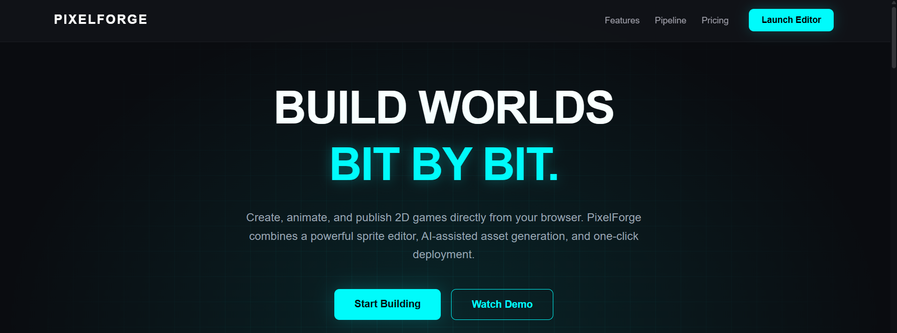

# PixelForge 🚀

PixelForge is a state-of-the-art, browser-based 2D game builder designed for professional game developers and artists. It combines traditional pixel art precision with cutting-edge AI workflows, allowing you to create, animate, and deploy game assets with unprecedented speed.



## ✨ Core Features

### 🎨 Professional Sprite Studio
- **Infinite Canvas Pattern**: GPU-accelerated rendering using Konva.js with support for large-scale pixel art.
- **Advanced Layer System**: Multi-layer compositing with opacity control, visibility toggles, and locking mechanisms.
- **Pixel-Perfect Tools**: Precision Pencil, Eraser, Flood Fill, and Selection tools designed for high-end pixel art.
- **Real-time Performance**: Optimized to maintain 60 FPS even with complex multi-layer sprites.

### 🤖 AI Generation
- **Retro Diffusion Integration**: Generate production-ready pixel art directly from natural language prompts, returned as true RGBA at the exact grid size.
- **AI Animation**: Turn any frame into a full animation cycle (idle, walk, run, attack, jump) from a single reference sprite.
- **Cost Transparency**: Prices are checked for free before any generation is billed.
- **Smart History**: Track and manage AI-generated assets with local caching and one-click application to the canvas.
- **Metadata Aware**: AI-generated sprites automatically sync with canvas dimensions and layer metadata.

### 🎞️ Animation & Timeline
- **Frame-by-Frame Animation**: Traditional animation workflow with a dedicated timeline bar.
- **Onion Skinning**: Visualize previous and next frames for smooth motion transitions.
- **Playback Control**: Real-time animation preview with adjustable FPS and looping options.
- **Frame Clipboard**: Batch copy, paste, and reorder frames to speed up animation cycles.

### 📦 Asset Management & Export
- **Smart Palette**: Save and manage custom color palettes with local persistence.
- **Multi-Format Export**: Export individual frames or full sprite sheets (atlas) optimized for game engines.
- **Source Integrity**: Export raw JSON data of your sprites for programmatic use or further editing.

## 🏗️ Technical Architecture

PixelForge is a **pnpm workspace monorepo**: the marketing site and the
editor are two separately deployed apps with two different stacks, sharing a
design-token package. See `AGENTS.md` for the full per-app rule set and
`docs/adr/0005-monorepo-split.md` for why.

- **Landing** (`apps/landing`): [Next.js 16](https://nextjs.org/) (App Router) + [TypeScript](https://www.typescriptlang.org/) — its own Vercel project.
- **Editor** (`apps/editor`): [Vite](https://vitejs.dev/) + [React 19](https://react.dev/) SPA + [react-router](https://reactrouter.com/) — its own Vercel project, with `api/ai/*.ts` Vercel Functions for the AI proxies.
- **State Management**: [Zustand](https://zustand-demo.pmnd.rs/) with a **Modular Slice Pattern** (editor only).
- **Rendering**: [Konva.js](https://konvajs.org/) for the high-performance 2D canvas (editor).
- **Styling**: [Tailwind CSS v4](https://tailwindcss.com/) (CSS-first), tokens shared via `packages/tokens`.
- **Backend/Auth**: [Supabase](https://supabase.com/) for cloud storage and user synchronization (editor).
- **Local Persistence**: IndexedDB for sprite/animation drafts (local-first — see `docs/adr/0006`/`0007`); `localStorage` for API keys and UI preferences only.

### Project Structure Breakdown

```
apps/
├── landing/                    # Next.js marketing site (its own Vercel project)
└── editor/                     # Vite SPA — the entire editor
    ├── api/ai/                 # Vercel Functions (Retro Diffusion, ElevenLabs proxies)
    └── src/
        ├── sprites/             # Sprite creation module
        │   ├── features/        # Feature-specific components (Layers, Tools, AI)
        │   └── hooks/            # Custom hooks for canvas and state interaction
        ├── sounds/               # Sound editor module
        ├── stores/              # Modular Zustand slices (Compound, Core, Tool, etc.)
        ├── lib/core/            # PixelCore boundary (TS today, Rust/Wasm in a later phase)
        └── types/               # Module-specific type definitions
packages/
└── tokens/                     # Shared design tokens (tokens.css, colors.ts) — no build step
```

## 🚀 Getting Started

### Prerequisites

- **Node.js**: 18.x or higher
- **Package Manager**: pnpm (recommended), npm, or bun
- **Supabase Account**: For authentication and cloud storage
- **AI Keys**: Retro Diffusion (sprites/animation) and ElevenLabs (audio) API keys (Optional)

### Installation

1. **Clone & Enter**:
   ```bash
   git clone https://github.com/JDavidcor23/pixelforge.git
   cd pixelforge
   ```

2. **Install Dependencies** (installs for every workspace package in one pass):
   ```bash
   pnpm install
   ```

3. **Environment Setup**:
   Each app has its own env vars — see `apps/landing/README.md` and
   `apps/editor/README.md` for the full list. The editor needs a local
   `.env.local` with your Supabase credentials:
   ```env
   VITE_SUPABASE_URL=your_project_url
   VITE_SUPABASE_ANON_KEY=your_anon_key
   ```

4. **Launch Development** (both apps in parallel, or target one):
   ```bash
   pnpm dev                              # both apps
   pnpm --filter @pixelforge/editor dev  # editor only (http://localhost:5173)
   pnpm --filter @pixelforge/landing dev # landing only (http://localhost:3000)
   ```

## 📖 Feature Documentation

For detailed technical guides on specific modules:
- [AI Setup & Usage](./docs/ai-setup.md)
- [Architecture Deep Dive](./docs/architecture.md)
- [Custom Tools Development](./docs/tools-guide.md)

## 🛡️ Security & Privacy

We take developer privacy seriously. **All sensitive API keys are stored exclusively in your browser's `localStorage`.** They are never sent to or stored on our servers, ensuring your tokens remain under your control.

## 📄 License

This project is licensed under the MIT License - see the [LICENSE](LICENSE) file for details.
