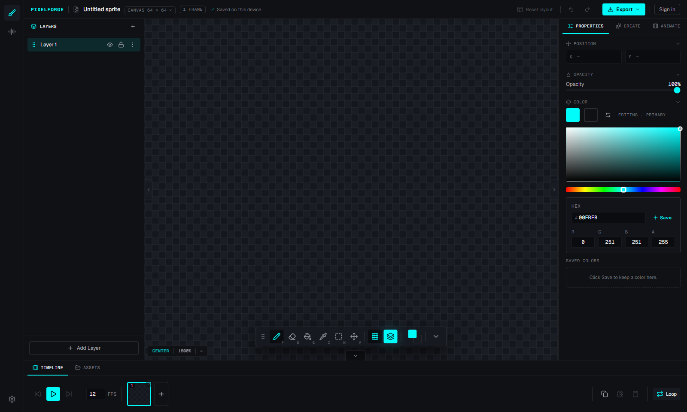
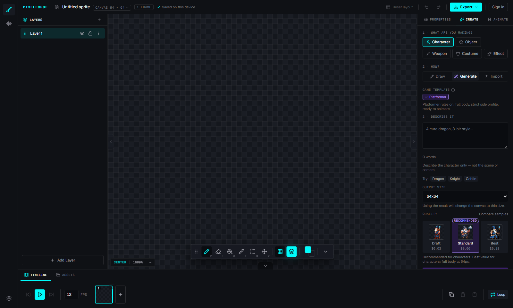
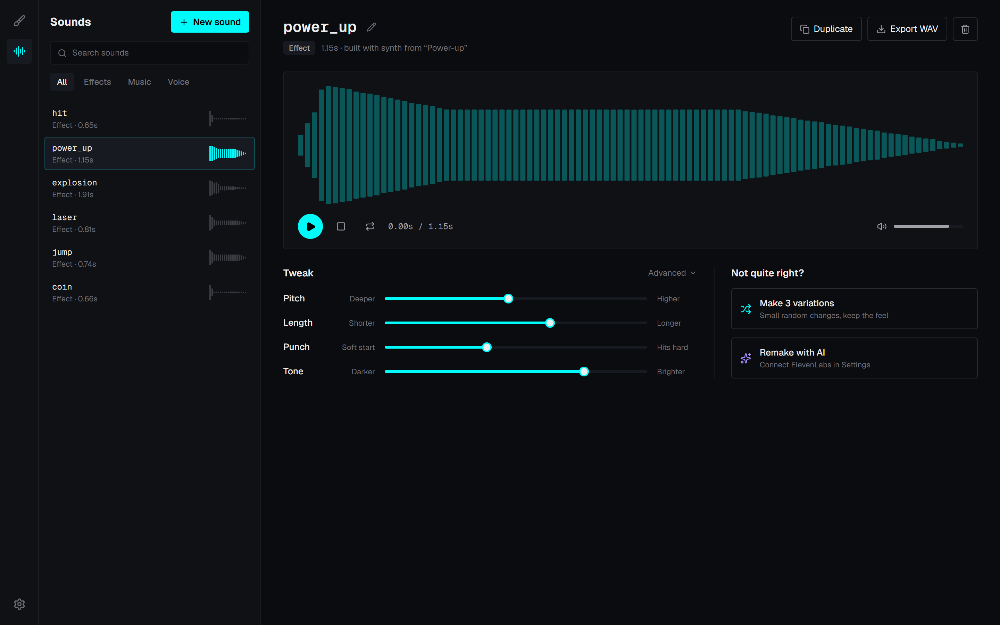
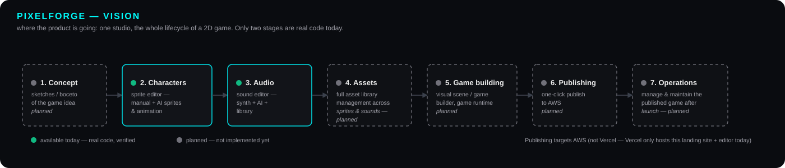

<h1 align="center">PixelForge IA</h1>

<p align="center">
  <strong>A browser-based 2D game studio in the making.</strong><br>
  Today: draw and animate sprites (by hand or with AI) and design sound
  effects, all from the browser. The goal: take a game from first sketch to
  a published, maintained release on AWS.
</p>

<p align="center">
  <a href="https://www.pixelforgeia.com">pixelforgeia.com</a>
</p>

<p align="center">
  <a href="LICENSE"></a>
  <a href="https://github.com/JDavidcor23/pixelforge/actions/workflows/ci.yml"></a>
</p>

---

## See it in action

**Sprite editor** — layered pixel canvas (Konva), pencil/eraser/fill/select,
onion skinning, frame-by-frame animation and export, built on an infinite,
zoomable canvas.

<p align="center">
  
</p>

**AI-assisted sprites** — generate pixel art and animation cycles from a text
prompt (Retro Diffusion), then drop results straight onto the canvas.

<p align="center">
  
</p>

**Sound editor** — a searchable sound library, one-click presets, a big
waveform with transport, plain-language tweaks (pitch, length, punch, tone),
random variations, and AI-generated effects, music and voice.

<p align="center">
  
</p>

## What works today

- **Sprite editor** — layered pixel canvas (Konva), pencil/eraser/fill/select,
  onion skinning, frame-by-frame animation, palette management, multi-format
  export. Manual drawing **and** AI-generated sprites (Retro Diffusion) and
  AI animation cycles from a single reference frame.
- **Sound editor** — a sound library with search and filters, presets, a
  waveform with transport, simple tweak sliders on top of the synthesizer
  (oscillator, envelope, filter), variations, WAV export, and AI-generated
  sounds (ElevenLabs).
- **Local-first persistence** — drafts autosave to IndexedDB; nothing is lost
  on reload, no account required.
- **A Rust/Wasm core migration, mid-flight** — the pixel engine is being moved
  from plain TypeScript to Rust compiled to WebAssembly, behind a runtime
  flag, with the TS implementation kept as the reference and default (see
  [Architecture & system design](#architecture--system-design) below).

## Vision — where PixelForge IA is going

The aim is one app covering the whole lifecycle of making a 2D game, not just
a sprite tool. Seven stages; today only two are real code — the rest is
roadmap, marked honestly below and in [`docs/lifecycle.svg`](docs/lifecycle.svg).

<p align="center">
  
</p>

| # | Stage | Status |
|---|-------|--------|
| 1 | Concept — sketches / *boceto* of the game | Planned |
| 2 | Characters & animation — sprite editor, manual + AI | **Available** |
| 3 | Audio — sound effects & music, synth + AI | **Available** |
| 4 | Assets — full asset library management | Planned |
| 5 | Game building — visual scene/game builder + runtime | Planned |
| 6 | Publishing — one-click deploy of the finished game to AWS | Planned |
| 7 | Operations — managing/maintaining the game after launch on AWS | Planned |

Vercel only hosts PixelForge IA's own `apps/landing` and `apps/editor` today.
The games built with PixelForge IA are meant to be published and operated on
AWS — that's a future stage, not something that exists yet.

## Made with PixelForge IA

Games built with PixelForge IA will be showcased here.

## Architecture & system design

Hexagonal ports & adapters, not a framework default: `PixelCore` and
`DocumentRepository` are interfaces first, with TS and Rust/Wasm adapters
plugging into the same seam. The Wasm core is validated against a TypeScript
reference with parity tests and 300-seed × 60-step differential fuzzing
before it's trusted — and measured honestly: the stateful document/history
core is currently *slower* on Wasm, so TS stays the default. Undo history
went from 576 KB to 8 bytes per stroke with a dirty-rect redesign.

→ Read [`docs/ARCHITECTURE.md`](docs/ARCHITECTURE.md) for the full breakdown,
the monorepo layout, testing setup and the ADRs behind each decision.

## Getting started

```bash
git clone https://github.com/JDavidcor23/pixelforge.git
cd pixelforge
pnpm install

pnpm --filter @pixelforge/editor dev   # editor — http://localhost:5173
pnpm --filter @pixelforge/landing dev  # landing — http://localhost:3000
pnpm dev                               # both, in parallel
```

The Rust toolchain is **only** needed if you're changing `packages/core`'s
Rust source — the compiled `pkg/` is committed, so `pnpm install` + `pnpm dev`
works with Node alone. To rebuild it:

```bash
cd packages/core
pnpm run build:wasm   # wasm-pack build, then strips the .gitignore it writes into pkg/
```

## Roadmap

- Supabase adapter for `DocumentRepository` (cloud sync, conflict resolution).
- Visual scene/game builder with a Phaser.js runtime (stages 1, 4–7 above).
- Batch `stroke.points` per animation frame to amortize the Wasm marshalling
  cost enough to flip the document core's default from `ts` to `wasm`.
- One-click publish to AWS for games built in the (future) scene builder,
  plus post-launch operations and maintenance.

## License

Apache License 2.0 — see [`LICENSE`](LICENSE) and [`NOTICE`](NOTICE).
