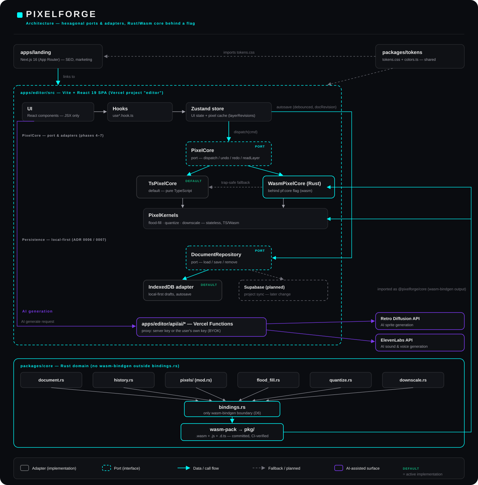

# Architecture

How PixelForge IA is built: hexagonal ports & adapters, a Rust/Wasm core with a
TypeScript reference, local-first persistence.

<p align="center">
  
</p>

## The ideas behind it

- **Hexagonal ports & adapters, not a framework default.** `PixelCore` (the
  pixel/document engine) and `DocumentRepository` (persistence) are defined
  as interfaces first. `TsPixelCore` and the IndexedDB repository are today's
  adapters; `WasmPixelCore` and a future Supabase adapter plug into the exact
  same seam without touching UI, hooks or store code.
- **A Rust/Wasm core with a TS reference, not a rewrite-and-pray.** Every
  Rust port (`pixel-buffer` → `flood-fill` → `quantize`/`downscale` →
  `document`/`history`) ships behind `PixelCore`/`PixelKernels`, validated
  against the TS implementation with parity tests and a 300-seed ×
  60-step differential fuzz test before anything is trusted.
- **Measured honestly, including the uncomfortable result.** The stateless
  kernels (flood-fill, quantize, downscale) *are* faster on Wasm and run on
  it whenever the flag is on. The stateful `Document`/history core is not:
  measured end-to-end in the real store loop it is **~1.5×–2.1× slower than
  TS**, because `stroke.points` fires many small wasm-bindgen calls per
  drawing gesture and the fixed marshalling cost per call outweighs the
  pixel work. That's why the default implementation is still **`ts`** — see
  [`../openspec/changes/migrate-to-rust-core/baseline-bench.md`](../openspec/changes/migrate-to-rust-core/baseline-bench.md)
  for the full numbers and [`design.md`](../openspec/changes/migrate-to-rust-core/design.md#current-status--follow-ups)
  for the reasoning.
- **Local-first persistence.** Drafts autosave to IndexedDB; a failed open
  (private browsing, quota, disabled storage) falls back to an in-memory
  repository so editing still works, just without persistence that session.
- **Dirty-rect, not deep-clone, undo history.** The old approach deep-cloned
  every layer in every frame per undo step — 576 KB for a single 1-pixel
  stroke on a 64×64/8-frame/4-layer document. The command-dispatch +
  dirty-rect design stores only the bytes a command actually touched: **8
  bytes** for that same stroke, a measured 73,728× reduction.
- **Reproducible Wasm builds, gated in CI.** `packages/core/pkg/` is
  committed; CI rebuilds it from source and fails the PR on any diff —
  including a brand-new untracked file, not just a changed one — so Rust and
  the compiled artifact can never silently drift apart. `cargo fmt`,
  `cargo clippy -D warnings`, `cargo test`, `cargo deny check`
  (licenses/advisories/bans/sources) and a 150 KB gzip budget on the `.wasm`
  all run on every PR.

## Toggling the core implementation

```js
// Browser console, while the editor is open
localStorage.setItem('pf:core', 'wasm') // try the Rust/Wasm document core
localStorage.setItem('pf:core', 'ts')   // back to the default
```

A trap inside `WasmPixelCore` (a genuine `WebAssembly.RuntimeError` or any
other exception) demotes that session to `TsPixelCore` automatically —
drawn content is preserved, that session's undo history is not.

## Monorepo layout

pnpm workspace, two separately deployed apps with two different stacks,
sharing design tokens and (increasingly) a Rust/Wasm core.

| Path | Stack | Deploys as |
|---|---|---|
| `apps/landing` | Next.js 16 (App Router), React 19 | Vercel project "landing" |
| `apps/editor` | Vite 6 + React 19 SPA, react-router-dom, Zustand, Konva | Vercel project "editor" (`api/ai/*` as Vercel Functions) |
| `packages/tokens` | CSS custom properties + TS — no build step | Imported directly by both apps |
| `packages/core` | Rust → `wasm-pack` → committed `pkg/` | Imported by `apps/editor` as `@pixelforge/core` |

See [`../AGENTS.md`](../AGENTS.md) for the full per-app rule set (navigation,
images, env var prefixes, `'use client'`) and
[`adr/0005-monorepo-split.md`](adr/0005-monorepo-split.md) for why
it's split this way.

## Testing & quality

```bash
pnpm run typecheck   # tsc --noEmit, every workspace package
pnpm run test        # Vitest, every workspace package
pnpm run bench       # Vitest benchmarks (pixel kernels + store-loop)
pnpm run check-bench # fails the build if a Wasm/TS bench ratio regresses past its budget

cd packages/core
cargo test           # Rust unit tests — pure domain, no wasm runtime needed
cargo clippy --all-targets -- -D warnings
cargo fmt --check
cargo deny check      # licenses, advisories, bans, sources
```

All of the above run in CI on every PR (`.github/workflows/ci.yml`), plus the
`pkg/` drift check and the `.wasm` gzip size budget described above.

## Decisions

- [`adr/`](adr) — 7 ADRs covering the flat pixel buffer, the
  document/dispatch seam, dirty-rect undo, the Rust/Wasm boundary shape, the
  monorepo split, and the IndexedDB/local-first persistence model.
- [`../openspec/changes/migrate-to-rust-core/proposal.md`](../openspec/changes/migrate-to-rust-core/proposal.md)
  and [`design.md`](../openspec/changes/migrate-to-rust-core/design.md) — the
  full phase-by-phase plan and the architectural reasoning behind it.
- [`../packages/core/LEARNING.md`](../packages/core/LEARNING.md) — plain-words
  notes on the Rust concepts used in the crate (ownership/borrowing, the
  wasm-bindgen marshalling cost, etc.), written while porting it as a JS/React
  developer.
